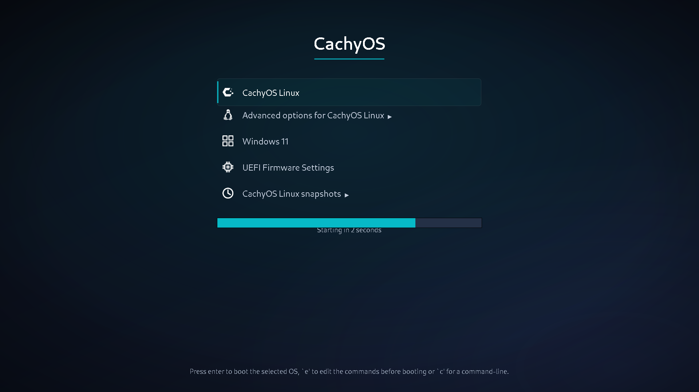

# cachyos-pro — a GRUB boot menu you can verify without rebooting

A themed, upgrade-safe GRUB boot menu for a CachyOS + Windows 11 dual-boot, plus a harness that
renders the real menu in a throwaway QEMU boot so every layout claim below is a measurement rather
than an opinion.



**Status:** verified in QEMU/OVMF against the machine's real generated `grub.cfg`. It has **not been
photographed on the physical panel** — a reboot is the one step this repo cannot do for you.

## What it does

| | |
|---|---|
| **Menu** | Firmware entries are not mirrored into GRUB (`31_efi_bootnext` disabled), Windows is pinned by ESP UUID instead of os-prober, snapshot list filtered to the meaningful rows |
| **Theme** | Centred 760 px column, 40 px entry icons, 4 px teal accent highlight, countdown bar flush with the selected row |
| **Durability** | Every `/etc/grub.d` edit lives in `tools/grub-menu-patches` (apply/verify) and is re-applied after each `grub` upgrade by a pacman hook — a patch that no longer matches is reported, never silently dropped |

## Measured

Environment: Lenovo Legion 82AU (1920x1080), CachyOS, GRUB 2.16, Cantarell 48/24/19 px.

| Claim | Measurement | How |
|---|---|---|
| Menu column | 760 x 400 px at x=580 (centre 960) | `theme/theme.txt`, confirmed in render |
| Icon optical box | all five icons max-dimension **30 px** at 1x | trimmed ink box per row in the render |
| Icon ink density | **47.0 – 62.0 %** (stock artwork: 40.2 – 85.2 %) | lit pixels / trimmed box |
| Countdown bar vs highlight | **+1 / −2 px** on each edge | teal fill + track extent vs the highlight's accent bar |
| Accent rule vs title descender | **14 px** clearance | title ink band vs rule band (0.3 em of the 48 px face) |
| Longest snapshot label | **642 px** in 668 px of text room | `magick label:` metrics over generated titles |
| Snapshot submenu | **100 → 20 rows** | `GRUB_BTRFS_LIMIT` + `IGNORE_SNAPSHOT_TYPE` replayed on the real 100 titles |
| Render iteration | ~15–45 s, no root, no reboot | `scripts/render-theme.sh` (standalone GRUB + FAT image + OVMF/KVM) |

## Verify it yourself

```bash
bash theme/build-assets.sh      # regenerate every asset from source
python3 tests/check.py          # assert the numbers in the table above
bash scripts/render-theme.sh    # boot it in QEMU and screenshot it (needs qemu + edk2-ovmf)
```

`tests/check.py` is the same script CI runs: it asserts the icon optical box, the geometry invariants
(the countdown bar is *derived* from `menu_left + item_padding`, `menu_width - 2*item_padding`, so an
edit that changes the padding without moving the bar fails), and that `grub-menu-patches` is
idempotent, complete, and loud about upstream text it can no longer find.

The render harness builds a standalone GRUB with an embedded menu that mirrors the real one, puts the
current theme on a 48 MB FAT image, and boots it under OVMF with the monitor socket as the control
channel — so the theme is exercised exactly as it renders on the machine, with no raw disk access.

## Requirements

Building the assets needs `rsvg-convert` (librsvg2-bin), ImageMagick, `grub-mkfont` (grub-common) and
the Cantarell + DejaVu Sans fonts; the render harness additionally needs `qemu-system-x86_64`,
`edk2-ovmf` and `mtools`. Font paths are discovered across the Arch and Debian layouts, and the build
fails with a named missing dependency rather than emitting a theme with no fonts.

The `c`-shell monospace face is copied from the installed stock CachyOS theme when one is present;
where it is absent the shell falls back to whichever font loaded, and `tests/check.py` reports the
substitution as a note instead of a failure.

## Install

```bash
sudo bash install/finish-theme.sh
```

Idempotent. It installs the theme, restores `GRUB_TIMEOUT`/`GRUB_GFXMODE` (a single GFXMODE with no
fallback drops to a text console), applies the `/etc/grub.d` patches, installs the pacman hook, and
regenerates `grub.cfg`.

**`install/` is this machine's configuration, not a generic installer** — `install/12_windows`
hardcodes the author's Windows ESP filesystem UUID (`F0E7-FD1E`) and `finish-theme.sh` writes to
`/etc/default/grub`. Change the UUID for your own disk (`lsblk -o NAME,FSTYPE,UUID`) before running it.

What a successful run looks like, in order:

```
== 1/5 ... 12_windows already current            (or "refreshed", or "moved stray …")
== 2/5 ... cachyos-pro assets rebuilt
== 3/5 ... GRUB_THEME='…/cachyos-pro/theme.txt'  grub.cfg syntax OK — installed
== 4/5 ... render-*.png frames (a refusal here means nothing was changed)
== 5/5 ... installed theme matches the sources   generated cfg: classes=[…] markers 1/1 saved_entry 4
          icon resolution      → 5 rows, all icon=yes
          duplicate-entry audit → Windows entries the generators produce: 1 (must be 1)
```

Any line reading `MISSING`, `STRAY`, `DRIFT`, `icon=MISSING`, or a count that is not `1` is a real
problem, and the line itself names the file to look at. Nothing is written to `grub.cfg` until the
generated config has passed `grub-script-check`.

### From scratch, on a different machine

```bash
git clone https://github.com/chethan62/cachyos-grub-theme && cd cachyos-grub-theme
lsblk -o NAME,FSTYPE,UUID | grep -i vfat     # find YOUR Windows ESP UUID
$EDITOR install/12_windows                   # put it in the fs-uuid line
sudo bash install/finish-theme.sh            # then reboot
```

The installer refuses to guess: if the UUID in `12_windows` is not on the machine it says so and tells
you how to list them. Anything it replaces is backed up to `/var/backups/cachyos-grub-theme/`.

Undo — dry run first, then apply:

```bash
sudo bash install/rollback.sh --apply                  # stock menu back; theme left on disk
sudo bash install/finish-theme.sh --uninstall --apply  # full uninstall: theme + helper removed
```

Both print the plan and change nothing until `--apply`. All guards run before the first destructive
step, so a missing backup refuses and leaves everything in place; anything replaced is kept in
`/var/backups/cachyos-grub-theme/`. `finish-theme.sh` with no arguments **installs** — there is
deliberately no uninstall-by-default.

## If the theme does not display

**Measured, not assumed** — both frames below were rendered by `scripts/render-theme.sh` against an
image the machine would boot from, and both are committed in `docs/screenshots/`:

| State | What actually happens |
|---|---|
| `GRUB_THEME` points at a **missing file** | One `error: file … not found` line and **"Press any key to continue…"** — **no menu, no entries at all** (`render-no-theme.png`). Modifier keys do not dismiss it (measured: three Shift presses left it unchanged); a real key does. On an unattended machine this **hangs the boot**. |
| **No `GRUB_THEME` at all** | GRUB's built-in menu with every entry listed, the first highlighted, and its countdown (`render-plain-menu.png`). This is the graceful state. |

So `install/finish-theme.sh` — and the pacman hook after a grub upgrade — now **unsets** `GRUB_THEME`
when `theme.txt` is missing, rather than leaving a config that stops at a prompt. Re-running the
installer restores the theme. Nothing here writes to the ESP or the firmware, so the firmware boot
menu and its `EFI Hard Drive` fallback are always still there.

| Symptom | Cause | Fix |
|---|---|---|
| Stops at `Press any key to continue…` | `GRUB_THEME` names a file that is not there | press a key to get the built-in menu, then re-run `install/finish-theme.sh` (or set `GRUB_THEME` to the stock `/usr/share/grub/themes/cachyos/theme.txt`) |
| Plain menu, no theme, no error | theme not applied: a font name that does not resolve, or a typo in a *global* property | rebuild with `theme/build-assets.sh`; confirm font names with `grub-mkfont` (never `-n`); check `GRUB_THEME` |
| Icons missing, or uneven sizes on some rows | a `/etc/grub.d` patch lost (grub upgraded without the hook), or `grub.cfg` not regenerated afterwards | `grub-menu-patches verify`, then `sudo grub-mkconfig -o /boot/grub/grub.cfg` |
| Menu appears but the countdown never ends | `GRUB_TIMEOUT` is `-1` (the capture phases set that) | `sudo sed -i "s/^GRUB_TIMEOUT=.*/GRUB_TIMEOUT='3'/" /etc/default/grub && sudo grub-mkconfig -o /boot/grub/grub.cfg` |
| Boots the other OS by default | `GRUB_DEFAULT=saved` remembers the last boot | `sudo grub-editenv /boot/grub/grubenv unset saved_entry` (or set `GRUB_DEFAULT=0`) |
| Text console instead of the menu | `GRUB_GFXMODE` without a fallback list | keep the trailing `,1024x768,auto` |
| Want none of it | | `sudo bash install/rollback.sh --apply` |

If the menu is unusable *at boot*: the snapshots submenu boots a pre-update system, the firmware boot
menu still lists the `EFI Hard Drive` fallback, and a live USB always works.

## How to boot if the menu is unusable

In order of effort. On this machine's firmware (`efibootmgr`, 2026-10): `0002 CachyOS` →
`\EFI\cachyos\grubx64.efi` (that is GRUB again), `0003 Windows 11` → Windows' own loader, `0000 EFI
Hard Drive` → the fallback copy of GRUB. **Only the Windows entry bypasses GRUB**, so it is the one
firmware route that works when GRUB itself will not start.

1. **`Press any key to continue…`** → press Enter or space. GRUB then draws its built-in menu with
   every entry listed; boot normally from there.
2. **Plain/unthemed menu** → fully usable: ↑/↓ then Enter. Nothing to repair in order to boot.
3. **Only Windows is needed** → reboot, press **F12** (Legion boot menu), pick `Windows 11`.
4. **GRUB's `grub>` prompt** (what a config it cannot parse leaves you at) → boot CachyOS by hand.
   These UUIDs are this machine's: btrfs root `5bb50285-d467-4766-8a59-6d1eefe8df60` (subvol `@`,
   at the filesystem top level), Windows ESP `F0E7-FD1E`.

   ```
   search --no-floppy --fs-uuid --set=root 5bb50285-d467-4766-8a59-6d1eefe8df60
   linux /@/boot/vmlinuz-linux-cachyos root=UUID=5bb50285-d467-4766-8a59-6d1eefe8df60 rw rootflags=subvol=@ nowatchdog nvme_load=YES
   initrd /@/boot/initramfs-linux-cachyos.img
   boot
   ```

   (drop `splash loglevel=3` from the normal line so the boot is visible; use
   `vmlinuz-linux-cachyos-lts` + its initramfs if the main kernel is the problem.) Windows from the
   same prompt:

   ```
   search --no-floppy --fs-uuid --set=root F0E7-FD1E
   chainloader /EFI/Microsoft/Boot/bootmgfw.efi
   boot
   ```

5. **Live USB** — the only route that can *repair* the install:

   ```
   cachy-chroot                                  # on the CachyOS ISO: mounts root + ESP for you
   # by hand: mount -o subvol=@ /dev/nvme0n1p2 /mnt && mount /dev/nvme0n1p1 /mnt/boot/efi
   grub-mkconfig -o /boot/grub/grub.cfg
   ```

   To go back to the stock menu instead, `cp /etc/default/grub.bak-theme /etc/default/grub` first.

## Layout

| Path | What |
|---|---|
| `theme/theme.txt` | the theme, with the reasoning for each measured value in comments |
| `theme/build-assets.sh` | generates background, highlight slices, fonts and icons (idempotent) |
| `tools/grub-menu-patches` | all `/etc/grub.d` edits, `apply` or `verify`; `GRUB_D` overridable for tests |
| `scripts/render-theme.sh`, `scripts/test-grub.cfg` | the QEMU render harness (standalone GRUB on a FAT image, no disk access) |
| `scripts/audit-menu.sh` | lists what every `/etc/grub.d` generator emits (read-only, no root) — submenus and duplicates included |
| `scripts/qemu-verify.sh` | end-to-end check of the **installed** theme: boots the real disk read-only and screenshots the menu |
| `install/` | this machine's installer, `12_windows`, `12_memtest`, and the pacman hook |
| `docs/` | research notes + the GRUB theme-format reference |
| `tests/check.py` | the checks CI runs |

## Gotchas (each cost a debugging session)

- **Styled-box PNGs must be RGBA** (`PNG32:`). GRUB decodes palette PNGs but ignores the `tRNS` chunk,
  so a palette+alpha slice renders fully opaque; grayscale and interlaced PNGs are rejected outright.
- **`grub-mkfont -n` sets the *family* name**, so GRUB looks up `Cantarell Regular 24 Regular 24`,
  misses, and silently falls back to Unifont. Omit `-n`; the derived name is the one to use.
- **The highlight is inset by `item_padding`**, so a bar aligned to the menu box sticks out ~16 px past
  the selected row. Align it to `box + padding` instead.
- **A missing `desktop-image` is fatal** (theme load aborts to a text menu); a missing box slice is
  silent; a typo in a global property aborts the theme while the same typo in a component is ignored.
- **A flat monochrome penguin is unrecognisable.** Tux reads as "penguin" because of its two-tone
  body; the flat version was tried, rendered, and reverted.
- **A patch must target the line that is EMITTED, not the first line that looks right.** The snapshots
  row's `--class` was inserted into the inner per-snapshot submenu line (`${title_menu}`, inside
  `grub-btrfs.cfg`) instead of the outer row the menu shows (`${submenuname}`, line 629 of
  `41_snapshots-btrfs`) — so it verified "ok", rendered nothing, and only a render of the real disk
  caught it. When a patch's success is claimed, assert the generated output as well as the script.
- **Right-aligning the submenu `▶` is impossible.** GRUB 2.16's theme format has no submenu-indicator
  property; the marker is part of the label string, so its x position drifts with the title length.

## Licensing

- **Code and theme: MIT** (see `LICENSE`).
- **Brand icons are not redistributed.** `build-assets.sh` reads `cachyos.png` and `linux.png` (Tux)
  from the *installed* stock CachyOS theme at build time; a machine without it still builds and simply
  shows no icon on those rows. The Windows, firmware and snapshot glyphs are drawn in this repo.
- **Fonts are read from the system** (Cantarell, OFL; DejaVu Sans, Bitstream Vera licence) and converted
  to GRUB `.pf2` at build time — no font binaries are committed here.
- The screenshots in `docs/screenshots/` are QEMU renders of this menu, including the two brand icons.
